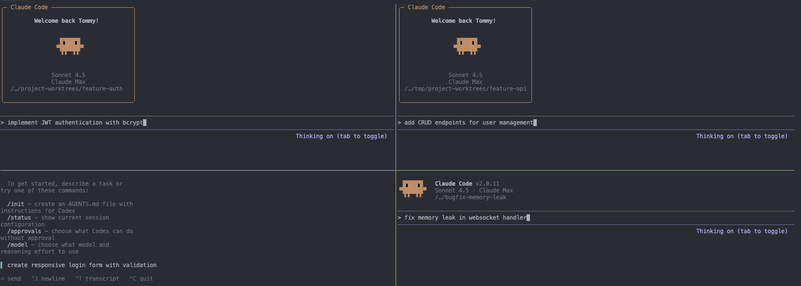

# wtr - Git Worktree Runner

[](LICENSE.txt)
[](https://www.gnu.org/software/bash/)
[](https://git-scm.com/)
[](#platform-support)

> A portable Git worktree CLI for PR reviews, coding agents, and repeatable per-branch setup



## Table of Contents

- [What are git worktrees?](#what-are-git-worktrees)
- [Quick Start](#quick-start)
- [AI Agent Usage](#ai-agent-usage)
- [Why wtr?](#why-wtr)
- [Features](#features)
- [Requirements](#requirements)
- [Commands](#commands)
- [Configuration](#configuration)
- [Shell Completions](#shell-completions-optional)
- [Platform Support](#platform-support)
- [Contributing](#contributing)
- [Maintainers](#maintainers)
- [License](#license)

---

## What are git worktrees?

**ELI5:** Normally, you can only work on one git branch at a time in a folder. Want to fix a bug while working on a feature? You have to stash changes, switch branches, then switch back. Git worktrees let you have multiple branches checked out at once in different folders - like having multiple copies of your project, each on a different branch.

**The Problem:** Everyone's using git worktrees wrong (or not at all):

- Constantly stashing/switching branches disrupts flow
- Running tests on main while working on features requires manual copying
- Reviewing PRs means stopping current work
- **Parallel AI agents on different branches?** Nearly impossible without worktrees

**Why people sleep on worktrees:** The DX is terrible. `git worktree add ../my-project-feature feature` is verbose, manual, and error-prone.

**Enter wtr:** Simple commands, AI tool integration, automatic setup, and built for modern parallel development workflows.

## Quick Start

**Homebrew (macOS):**

```bash
brew tap neopilot-ai/tap
brew install git-wtr
```

**Install from source (macOS / Linux):**

```bash
git clone https://github.com/neopilot-ai/wtr.git
cd wtr
./install.sh
```

<details>
<summary><b>Other installation options</b></summary>

**macOS (Intel) / Linux:**

```bash
sudo mkdir -p /usr/local/bin
sudo ln -s "$(pwd)/bin/git-wtr" /usr/local/bin/git-wtr
```

**User-local (no sudo required):**

```bash
mkdir -p ~/.local/bin
ln -s "$(pwd)/bin/git-wtr" ~/.local/bin/git-wtr
# Add to ~/.zshrc or ~/.bashrc if ~/.local/bin is not in PATH:
# export PATH="$HOME/.local/bin:$PATH"
```

</details>

**Usage:**

```bash
# Navigate to your git repo
cd ~/GitHub/my-project

# One-time setup (per repository)
git wtr config set wtr.editor.default cursor
git wtr config set wtr.ai.default claude

# Daily workflow
git wtr new my-feature          # Create worktree folder: my-feature
git wtr new my-feature --editor # Create and open in editor
git wtr new my-feature --ai     # Create and start AI tool
git wtr new my-feature -e -a    # Create, open editor, then start AI
git wtr pr 123                  # Create worktree for pull request #123
git wtr editor my-feature       # Open in cursor
git wtr ai my-feature           # Start claude

# Run commands in worktree
git wtr run my-feature npm test # Run tests

# Navigate to worktree
wtr new my-feature --cd         # Create and cd (requires shell integration)
wtr pr 123 --cd                 # Create a PR worktree and cd
wtr cd                          # Interactive picker (requires fzf + shell integration)
wtr cd my-feature               # Requires shell integration (see below)
cd "$(git wtr go my-feature)"   # Alternative without shell integration

# List all worktrees
git wtr list

# Remove when done
git wtr rm my-feature

# Or remove all worktrees with merged or closed PRs/MRs (requires gh or glab CLI)
git wtr clean --merged --closed
```

## AI Agent Usage

Shell-capable coding agents can use `git wtr` directly; a separate MCP server is
not required. Use `git wtr new <branch> --porcelain` to create a worktree and
reliably capture its path, then run the agent inside that directory. Built-in
adapters cover popular tools, while the safe `PATH` fallback works with other
agent CLIs without requiring a dedicated adapter.

See [docs/agent-usage.md](docs/agent-usage.md) for a copy-paste `AGENTS.md`
policy, output contract, and safe lifecycle examples.

## Why wtr?

While `git worktree` is powerful, it's verbose and manual. `git wtr` adds quality-of-life features for modern development:

| Task              | With `git worktree`                        | With `git wtr`                           |
| ----------------- | ------------------------------------------ | ---------------------------------------- |
| Create worktree   | `git worktree add ../repo-feature feature` | `git wtr new feature`                    |
| Create + open     | `git worktree add ... && cursor .`         | `git wtr new feature --editor`           |
| Checkout PR       | `gh pr checkout 123`                       | `git wtr pr 123`                         |
| Open in editor    | `cd ../repo-feature && cursor .`           | `git wtr editor feature`                 |
| Start AI tool     | `cd ../repo-feature && claude`             | `git wtr ai feature`                     |
| Copy config files | Manual copy/paste                          | Auto-copy via `wtr.copy.include`         |
| Run build steps   | Manual `npm install && npm run build`      | Auto-run via `wtr.hook.postCreate`       |
| List worktrees    | `git worktree list` (shows paths)          | `git wtr list` (shows branches + status) |
| Clean up          | `git worktree remove ../repo-feature`      | `git wtr rm feature`                     |

**TL;DR:** `git wtr` wraps `git worktree` with quality-of-life features for modern development workflows (AI tools, editors, automation).

## Features

- **Simple commands** - Create and manage worktrees with intuitive CLI
- **Repository-scoped** - Each repo has independent worktrees
- **Configuration over flags** - Set defaults once, use simple commands
- **Editor integration** - Open worktrees in Antigravity, Cursor, VS Code, Zed, and more
- **AI tool support** - Launch Claude Code, Codex, Gemini CLI, or any safe command in `PATH`
- **Smart file copying** - Selectively copy configs/env files to new worktrees
- **Hooks system** - Run custom commands after create/remove
- **Cross-platform** - Works on macOS, Linux, and Windows (Git Bash)
- **Shell completions** - Tab completion for Bash, Zsh, and Fish

## Requirements

- **Git** 2.17+ (for `git worktree move/remove` support)
- **Bash** 3.2+ (macOS ships 3.2; 4.0+ recommended for advanced features)

## Commands

Commands accept branch names to identify worktrees. Use `1` to reference the main repo.
Run `git wtr help` for full documentation.

### `git wtr new <branch> [options]`

Create a new git worktree. Folder is named after the branch.

```bash
git wtr new my-feature                                                                   # Creates folder: my-feature
git wtr new hotfix --from v1.2.3                                                         # Create from specific ref
git wtr new variant-1 --from-current                                                     # Create from current branch
git wtr new feature/auth                                                                 # Creates folder: feature-auth
git wtr new feature/implement-user-authentication-with-oauth2-integration --folder auth  # Custom folder name
git wtr new feature-auth --name backend --force                                          # Same branch, custom name
git wtr new my-feature --name descriptive-variant                                        # Optional: custom name without --force
git wtr new agent-task --porcelain                                                       # Stable output for automation
```

**Options:**

- `--from <ref>`: Create from specific ref
- `--from-current`: Create from current branch (useful for parallel variant work)
- `--remote <name>`: Remote used for default base refs
- `--track <mode>`: Tracking mode (auto|remote|local|none)
- `--no-copy`: Skip file copying
- `--no-fetch`: Skip git fetch
- `--no-hooks`: Skip post-create hooks
- `--sparse`: Inherit sparse-checkout from the base worktree (Git 2.36+; overrides `wtr.sparse.inherit = false`)
- `--no-sparse`: Force a full checkout even when `wtr.sparse.inherit` is on
- `--force`: Allow same branch in multiple worktrees (**requires --name or --folder**)
- `--name <suffix>`: Custom folder name suffix (optional, required with --force)
- `--folder <name>`: Custom folder name (replaces default, useful for long branch names)
- `--editor`, `-e`: Open in editor after creation
- `--ai`, `-a`: Start AI tool after creation
- `--yes`: Non-interactive mode
- `--porcelain`: Emit stable `key<TAB>value` records (implies `--yes`; incompatible with `--editor` and `--ai`)

On success, `--porcelain` writes exactly three records to stdout: `path`,
`branch`, and `hook_status`. Progress messages and hook output are written to
stderr. If a post-create hook fails, the command exits non-zero and emits no
success records. See [AI agent usage](docs/agent-usage.md) for the format and
recommended safety boundaries.

### `git wtr pr <number|url|branch> [options]`

Create a worktree from a GitHub pull request. Requires GitHub CLI (`gh`) for PR lookup.
When supported, WTR delegates checkout to `gh pr checkout --worktree`; otherwise it
uses a compatibility path that preserves configured Git remotes and protocols.
The default local branch is the PR head branch so GitHub CLI can infer the PR from inside the worktree.

```bash
git wtr pr 123                         # Branch/folder from PR head branch
git wtr pr 123 --branch review/fix     # Custom local branch
git wtr pr 123 --folder review         # Custom folder name
wtr pr 123 --cd                        # Create and cd with shell integration
```

**Options:**

- `--branch <name>`, `-b`: Local branch name to use (default: PR head branch)
- `--repo <repo>`, `-R`: Repository for `gh pr view`
- `--remote <name>`: Override remote/repository used to fetch `refs/pull/<number>/head`
- `--no-copy`: Skip file copying
- `--no-hooks`: Skip post-create hooks
- `--force`: Allow same branch in multiple worktrees (**requires --name or --folder**)
- `--name <suffix>`: Custom folder name suffix
- `--folder <name>`: Custom folder name
- `--editor`, `-e`: Open in editor after creation
- `--ai`, `-a`: Start AI tool after creation
- `--yes`: Non-interactive mode

### `git wtr editor <branch> [--editor <name>]`

Open worktree in editor (uses `wtr.editor.default` or `--editor` flag).

```bash
git wtr editor my-feature                    # Uses configured editor
git wtr editor my-feature --editor vscode    # Override with vscode
```

### `git wtr ai <branch> [--ai <name>] [-- args...]`

Start AI coding tool (uses `wtr.ai.default` or `--ai` flag).

```bash
git wtr ai my-feature                      # Uses configured AI tool
git wtr ai my-feature --ai codex          # Override with different tool
git wtr ai my-feature -- --verbose        # Pass arguments to tool
git wtr ai 1                              # Use AI in main repo
```

### `git wtr go <branch>`

Print worktree path for shell navigation.

```bash
cd "$(git wtr go my-feature)"    # Navigate by branch name
cd "$(git wtr go 1)"             # Navigate to main repo
```

**Tip:** For easier navigation, use `git wtr init` to enable `wtr cd`:

```bash
# Bash (add to ~/.bashrc)
_wtr_init="${XDG_CACHE_HOME:-$HOME/.cache}/wtr/init-wtr.bash"
[[ -f "$_wtr_init" ]] && head -n 1 "$_wtr_init" | grep -q ' init=6 ' || eval "$(git wtr init bash)" || true
source "$_wtr_init" 2>/dev/null || true; unset _wtr_init

# Zsh (add to ~/.zshrc)
_wtr_init="${XDG_CACHE_HOME:-$HOME/.cache}/wtr/init-wtr.zsh"
[[ -f "$_wtr_init" ]] && head -n 1 "$_wtr_init" | grep -q ' init=6 ' || eval "$(git wtr init zsh)" || true
source "$_wtr_init" 2>/dev/null || true; unset _wtr_init

# Fish (add to ~/.config/fish/config.fish)
set -l _wtr_init (test -n "$XDG_CACHE_HOME" && echo $XDG_CACHE_HOME || echo $HOME/.cache)/wtr/init-wtr.fish
test -f "$_wtr_init"; and head -n 1 "$_wtr_init" | string match -q '* init=6 *'; or git wtr init fish >/dev/null 2>&1
source "$_wtr_init" 2>/dev/null

# Then navigate with:
wtr new my-feature --cd  # Create and land in the new worktree
wtr pr 123 --cd          # Create PR worktree and land in it
wtr cd                # Interactive worktree picker (requires fzf)
wtr cd my-feature
wtr cd 1
```

The cache generates on first run and refreshes the next time `git wtr init <shell>` runs. To force-regenerate: `rm -rf ~/.cache/wtr`

With [fzf](https://github.com/junegunn/fzf) installed, `wtr cd` (no arguments) opens a command palette with git log preview and keybindings: `ctrl-e` editor, `ctrl-a` AI, `ctrl-d` delete, `ctrl-y` copy, `ctrl-r` refresh.

> **Note:** If `wtr` conflicts with another command (e.g., GNU `tr` from coreutils), use `--as` to pick a different name:
>
> ```bash
> eval "$(git wtr init zsh --as gwtr)"
> gwtr cd my-feature
> ```

### `git wtr run <branch> <command...>`

Execute command in worktree directory.

```bash
git wtr run my-feature npm test             # Run tests
git wtr run my-feature npm run dev          # Start dev server
git wtr run feature-auth git status         # Run git commands
git wtr run 1 npm run build                 # Run in main repo
```

### `git wtr rm <branch>... [options]`

Remove worktree(s) by branch name.

```bash
git wtr rm my-feature                              # Remove one
git wtr rm feature-a feature-b                     # Remove multiple
git wtr rm my-feature --delete-branch --force      # Delete branch and force
```

**Options:** `--delete-branch`, `--force`, `--yes`

### `git wtr mv <old> <new> [--force] [--yes]`

Rename worktree directory and branch together. Aliases: `rename`

```bash
git wtr mv feature-wip feature-auth      # Rename worktree and branch
git wtr mv old-name new-name --force     # Force rename locked worktree
git wtr mv old-name new-name --yes       # Skip confirmation
```

**Options:** `--force`, `--yes`

**Note:** Only renames the local branch. Remote branch remains unchanged.

### `git wtr copy <target>... [options] [-- <pattern>...]`

Copy files from main repo to existing worktree(s). Useful for syncing env files after worktree creation.

```bash
git wtr copy my-feature                       # Uses wtr.copy.include patterns
git wtr copy my-feature -- ".env*"            # Explicit pattern
git wtr copy my-feature -- ".env*" "*.json"   # Multiple patterns
git wtr copy -a -- ".env*"                    # Copy to all worktrees
git wtr copy my-feature -n -- "**/.env*"      # Dry-run preview
```

**Options:**

- `-n, --dry-run`: Preview without copying
- `-a, --all`: Copy to all worktrees
- `--from <source>`: Copy from different worktree (default: main repo)

### `git wtr list [--porcelain]`

List all worktrees. Use `--porcelain` for machine-readable output.

### `git wtr config {get|set|add|unset|list} <key> [value] [--global]`

Manage configuration via git config.

```bash
git wtr config set wtr.editor.default cursor       # Set locally
git wtr config set wtr.ai.default claude --global  # Set globally
git wtr config get wtr.editor.default              # Get value
git wtr config list                                # List all wtr config
```

### `git wtr clean [options]`

Remove worktrees: clean up empty directories, or remove those with merged or closed PRs/MRs.

```bash
git wtr clean                                  # Remove empty worktree directories and prune
git wtr clean --merged                         # Remove worktrees for merged PRs/MRs
git wtr clean --closed                         # Remove worktrees for closed PRs/MRs
git wtr clean --merged --closed --to main      # Remove worktrees for merged or closed PRs/MRs targeting main
git wtr clean --merged --dry-run               # Preview which worktrees would be removed
git wtr clean --merged --yes                   # Remove without confirmation prompts
git wtr clean --merged --force                 # Force-clean PR cleanup, ignoring local changes
git wtr clean --merged --force --yes           # Force-clean and auto-confirm
```

**Options:**

- `--merged`: Remove worktrees whose branches have merged PRs/MRs (also deletes the branch)
- `--closed`: Remove worktrees whose branches have closed PRs/MRs (also deletes the branch)
- `--to <ref>`: Limit PR/MR cleanup to PRs/MRs targeting the given base ref
- `--dry-run`, `-n`: Preview changes without removing
- `--yes`, `-y`: Non-interactive mode (skip confirmation prompts)
- `--force`, `-f`: Force removal even if worktree has uncommitted changes or untracked files

**Note:** The `--merged`/`--closed` mode auto-detects your hosting provider (GitHub or GitLab) from the `origin` remote URL and requires the corresponding CLI tool (`gh` or `glab`) to be installed and authenticated. For self-hosted instances, set the provider explicitly: `git wtr config set wtr.provider gitlab`.

**Note:** `clean` also detects registry entries that are locked but whose directories no longer exist (for example, a crashed agent session that deleted its worktree directory). `git worktree prune` skips locked entries by design, so these linger and keep their branches checked out. `clean` offers to unlock and prune them; `--force` or `--yes` confirms automatically.

### `git wtr trust`

Review and approve executable commands defined in the repository's `.wtrconfig` file. Hooks and editor/AI defaults from `.wtrconfig` are **not used** until explicitly trusted — this prevents malicious contributors from injecting arbitrary shell commands via shared config files.

```bash
git wtr trust                              # Review and approve .wtrconfig commands
```

Trust is bound to the repository path, the filesystem identity of its common Git directory, and executable command definitions. Replacing or recloning a repository at the same path, or changing hooks or editor/AI defaults, requires approval again. Older path-only approvals also require renewal. Hooks and defaults from your local git config (`.git/config`, `~/.gitconfig`) are always trusted.

Approval covers command definitions and the behavior they delegate to. It does not hash or pin scripts, dependencies, or tools: for example, approving `sh ./scripts/setup.sh` allows subsequent changes to that script within the same repository. Review delegated code and trust the repository's contributors before approving commands.

Trust requires a known filesystem birth time for the Git directory. If `stat` cannot provide it, `.wtrconfig` executable commands remain untrusted.

### Other Commands

- `git wtr doctor` - Health check (verify git, editors, AI tools)
- `git wtr adapter` - List available editor & AI adapters
- `git wtr version` - Show version

## Configuration

All configuration is stored via `git config`. For team settings, create a `.wtrconfig` file in your repository root.

### Quick Setup

```bash
# Set your editor (antigravity, cursor, vscode, zed)
git wtr config set wtr.editor.default cursor

# Set your AI tool (antigravity, aider, auggie, claude, codex, copilot, cursor, gemini, opencode)
git wtr config set wtr.ai.default claude

# Override-backed adapters may include flags
git wtr config set wtr.editor.default "nano -w"
git wtr config set wtr.ai.default "claude --continue"

# Generic fallbacks support other safe PATH commands without dedicated adapters
git wtr config set wtr.editor.default "code --wait"
git wtr config set wtr.ai.default goose

# Copy env files to new worktrees
git wtr config add wtr.copy.include "**/.env.example"

# Run setup after creating worktrees
git wtr config add wtr.hook.postCreate "npm install"

# Inherit sparse-checkout from the base worktree on Git 2.36+ (default: on)
git wtr config set wtr.sparse.inherit true

# Re-source environment after wtr cd, wtr new --cd, or wtr pr --cd (runs in current shell)
git wtr config add wtr.hook.postCd "source ./vars.sh"

# Disable color output (or use "always" to force it)
git wtr config set wtr.ui.color never
```

### Team Configuration (.wtrconfig)

```gitconfig
# .wtrconfig - commit this to share settings
[copy]
    include = **/.env.example
    exclude = **/.env
    includeDirs = node_modules
    includeDirs = packages/*/generated
    excludeDirs = node_modules/.cache

[hooks]
    postCreate = npm install

[defaults]
    editor = cursor
    ai = claude
    remote = upstream
```

**Command trust:** Hooks and editor/AI defaults defined in `.wtrconfig` require explicit approval before they execute or select tools. Run `git wtr trust` after cloning a repository or when `.wtrconfig` command entries change. This protects against malicious command injection in shared repositories.

**Adapter safety:** Generic `wtr.editor.default` and `wtr.ai.default` values must resolve to safe PATH commands. Filesystem paths such as `./tool` and shell wrapper forms such as `sh -c ...` are rejected. Override-backed adapters like `claude`, `cursor`, and `nano` may include additional flags, for example `claude --continue` or `nano -w`.

**Configuration precedence** (highest to lowest):

1. `git config --local` (`.git/config`) - personal overrides
2. `.wtrconfig` (repo root) - team defaults (hooks and editor/AI defaults require `git wtr trust`)
3. `git config --global` (`~/.gitconfig`) - user defaults
4. `git config --system` (`/etc/gitconfig`) - system defaults
5. Environment variables
6. Built-in defaults

> For complete configuration reference including all settings, hooks, file copying patterns, and environment variables, see [docs/configuration.md](docs/configuration.md)

## Shell Completions (Optional)

Homebrew installs native Bash, Zsh, and Fish completion files automatically.
Use the commands below for manual setup when installing from source or when you
want to load completions explicitly.

```bash
# Bash (~/.bashrc)
source <(git wtr completion bash)

# Zsh (~/.zshrc) - must be before compinit
eval "$(git wtr completion zsh)"

# Fish
mkdir -p ~/.config/fish/completions
git wtr completion fish > ~/.config/fish/completions/git-wtr.fish
```

> For troubleshooting, see [docs/configuration.md#shell-completions](docs/configuration.md#shell-completions)

## Platform Support

| Platform    | Status          | Notes                           |
| ----------- | --------------- | ------------------------------- |
| **macOS**   | Full support    | Ventura+ recommended            |
| **Linux**   | Full support    | Ubuntu, Fedora, Arch, etc.      |
| **Windows** | Git Bash or WSL | Native PowerShell not supported |

Requires Git 2.17+ and Bash 3.2+.

> For troubleshooting, platform-specific notes, and architecture details, see [docs/troubleshooting.md](docs/troubleshooting.md)

## Advanced Usage

For advanced workflows including:

- **Multiple worktrees on same branch** (`--force` + `--name`)
- **Parallel AI agent development** patterns
- **Custom workflow scripts** (`.wtr-setup.sh`)
- **CI/CD automation** (non-interactive mode)
- **Working with multiple repositories**

See [docs/advanced-usage.md](docs/advanced-usage.md)

## Contributing

Contributions welcome! Areas where help is appreciated:

- **New editor adapters** - Editors that need behavior beyond the safe `PATH` fallback
- **New AI tool adapters** - Agent CLIs that need custom launch or discovery logic
- **Bug reports** - Platform-specific issues
- **Documentation** - Tutorials, examples, use cases

See [CONTRIBUTING.md](CONTRIBUTING.md) for guidelines and [CODE_OF_CONDUCT.md](CODE_OF_CONDUCT.md) for community standards.

## Maintainers

wtr was created and is maintained by [@helizaga](https://github.com/helizaga).

Much of what wtr supports today came from outside contributors - editor and AI tool adapters, platform
fixes, shell integrations, and documentation. See the
[contributor list](https://github.com/neopilot-ai/wtr/graphs/contributors) for everyone
who has shipped something here.

## License

This project is licensed under the [Apache License 2.0](LICENSE.txt).

---

Built to streamline parallel development workflows with git worktrees.

For questions or issues, [open an issue](https://github.com/neopilot-ai/wtr/issues).
